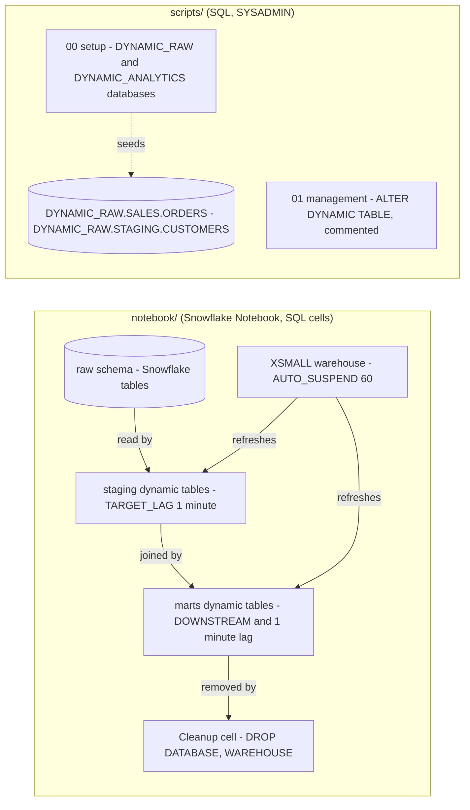

# Snowflake Dynamic Tables - Architecture and design rationale

*Last updated: 2026-11-07 · commit 2edefc322*

## 1. Purpose and scope

A learning tutorial on Snowflake dynamic tables: declaring a table as a query, letting `TARGET_LAG` decide how fresh it
is, chaining tables with `DOWNSTREAM` lag, and managing them with suspend, resume and manual refresh. The worked example
is a small star schema (a customer dimension and a daily sales fact) built over raw orders.

It is not a pipeline design for real volumes and has no performance measurements. The repository does not say what kind
of account the material was run on (`TODO: verify`).

## 2. How this project was built

This project was built with Claude Code (Anthropic's AI coding assistant) in a complementary role. Elliott Fairhall is
the author and owner: the project is debugged, tested and used by him for learning and development, and the design
decisions below are explained so that they can be understood, questioned and learned from. AI assistance does not
replace that work. The repository does not record how much of each file was run or reviewed, so the document makes no
claim about that beyond the statement above.

## 3. Architecture at a glance

The content is split in two. The notebook holds the real exercise; the `scripts/` folder holds supporting material.

In the notebook, two staging tables read raw data, a customer dimension (lag `DOWNSTREAM`) and a daily sales fact (lag
one minute) build on them, and one XSMALL warehouse refreshes everything. The scripts do not create a dynamic table.

## 4. Learning path

| Order      | File                         | Teaches                                                                 | Why here                                                                   |
| ---------- | ---------------------------- | ----------------------------------------------------------------------- | -------------------------------------------------------------------------- |
| Notebook 1 | Setup and raw tables         | A database, three schemas, an XSMALL warehouse with `AUTO_SUSPEND = 60` | A dynamic table needs a warehouse and a source before anything is declared |
| Notebook 2 | Insert sample data           | Customers, products and orders                                          | Enough rows for joins and aggregates                                       |
| Notebook 3 | Staging dynamic tables       | `CREATE DYNAMIC TABLE` with `WAREHOUSE` and `TARGET_LAG = '1 minute'`   | The simplest form: one source, one transform                               |
| Notebook 4 | Marts dynamic tables         | `TARGET_LAG = DOWNSTREAM`, a dimension and a fact                       | Chaining; shows lag derived from consumers                                 |
| Notebook 5 | Insert new data              | Watch the tables refresh without any task                               | The payoff, shown after the model is in place                              |
| Notebook 6 | Monitor                      | Refresh history and state                                               | Observing what the warehouse is doing                                      |
| Notebook 7 | Manage                       | Suspend, resume, manual refresh                                         | Cost control, taught after the learner has seen them run                   |
| Notebook 8 | Cleanup                      | Drop the database and warehouse                                         | Stops the one-minute refresh from spending credits                         |
| Script 00  | `00_setup_environment.sql`   | `DYNAMIC_RAW.SALES.ORDERS` and `DYNAMIC_RAW.STAGING.CUSTOMERS`          | Source tables only; see section 8                                          |
| Script 01  | `01_management_commands.sql` | Suspend, resume, refresh as commented placeholders                      | Quick reference for step 7                                                 |

The order is declare, chain, observe, control, clean up. Management comes late because suspend and refresh only mean
something once a table is refreshing. Cleanup is last and non-optional for a one-minute target lag.

## 5. Isolation, idempotency and cleanup

- **Notebook:** `dynamic_tables_tutorial_db` and `dynamic_tables_wh`, both dropped in the last cell. Its first statement
  is `CREATE OR REPLACE DATABASE`, so it replaces any database with that name, which is acceptable because the name is
  specific to this tutorial.
- **Scripts:** use databases `DYNAMIC_RAW` and `DYNAMIC_ANALYTICS` (tutorial-prefixed since 2026-11-07) with
  `IF NOT EXISTS`, then `CREATE OR REPLACE TABLE` on the source tables. No cleanup, and no warehouse is created.
- **Cost:** the notebook uses an XSMALL warehouse that suspends after 60 seconds. Each dynamic table with a one-minute
  lag refreshes on a schedule, so a forgotten tutorial keeps spending credits. That is the main cost risk.
- **Safety:** all rows are invented; no personal data.

## 6. Design rationale

### Teach with a notebook and keep the scripts thin

- **Why:** dynamic tables are only convincing when you insert a row and watch the output change. A notebook lets that be
  one continuous session; static SQL files can only show syntax.
- **Gave up:** the `scripts/` folder is not a standalone path. Script 01 is entirely commented placeholders against a
  non-existent `my_dynamic_table`, and script 00 creates different source tables from the notebook's
  (`DYNAMIC_RAW.SALES.ORDERS` has `TOTAL_AMOUNT`; the notebook's `raw.orders` has product, quantity and unit price).
- **Alternative not taken:** extract each notebook cell into a numbered script, as the other tutorials do. The README
  describes `scripts/` as "extracted SQL management scripts", so the thin set may be deliberate (`TODO: verify`).
- **Evidence:** documented (README) for the description; the rest inferred.

### A star schema over raw orders, three layers deep

- **Why:** a dimension and a fact built on staging tables is a recognisable shape and shows both a plain aggregate and a
  join. It is documented in the tutorial text as "STAR Schema data modelling".
- **Gave up:** only two staging tables, one dimension and one fact; no incremental-versus-full refresh comparison and no
  large data.
- **Alternative not taken:** a single dynamic table. Simpler, but it cannot show chaining.
- **Evidence:** documented (tutorial) and in the notebook.

### One-minute lag on staging and the fact, `DOWNSTREAM` on the dimension

- **Why (reconstructed):** one minute makes refresh visible during a tutorial session. `DOWNSTREAM` on the dimension
  shows the lag being driven by consumers.
- **Gave up:** one minute is the opposite of what most pipelines need, and is the cost driver. The dimension has no
  consumer in the notebook, so its effective lag depends on `DOWNSTREAM` rules that the notebook does not demonstrate
  (`TODO: verify` behaviour with no downstream consumer).
- **Alternative not taken:** hours-long lag with manual refresh only. Cheaper, but nothing visibly happens.
- **Evidence:** inferred from the code.

### A dedicated XSMALL warehouse that suspends quickly

- **Why:** the tutorial states dynamic tables need a user-specified warehouse; a dedicated XSMALL one keeps cost
  attributable and tiny.
- **Gave up:** no sizing guidance, no resource monitor.
- **Alternative not taken:** the shared default warehouse, which makes cost invisible and cleanup riskier.
- **Evidence:** documented (tutorial) for the requirement; the sizing is inferred.

### Trade-offs against production practice

| Tutorial choice                   | Production practice                                                                                                                           |
| --------------------------------- | --------------------------------------------------------------------------------------------------------------------------------------------- |
| One-minute lag                    | Lag set from the freshness the consumer actually needs                                                                                        |
| `CREATE OR REPLACE DYNAMIC TABLE` | Replacing resets refresh state and may force a full refresh (`TODO: verify`); use `CREATE OR ALTER` where it applies (`TODO: verify` support) |
| Hand-inserted rows                | Real ingestion from stages or streams                                                                                                         |
| No refresh-mode discussion        | Checking whether a query refreshes incrementally or in full                                                                                   |
| Preview status in prose           | Check current availability in the documentation                                                                                               |

## 7. Quality and testing

No automated tests. The notebook's insert-and-observe step is the check. The repository records no expected outputs. The
tutorial's statement that dynamic tables are in "Public Preview" is dated and probably stale (`TODO: verify`).

## 8. Constraints, limitations and known gaps

- `scripts/` creates no dynamic table; script 01 is placeholder comments.
- The README structure shows a `scripts/` set of one file and tells the learner to run `00_setup_environment.sql`, which
  exists but is not listed; the Tutorial markdown contains a link to a separate older repository location.
- Script 00 source tables differ from the notebook's, so the two paths do not combine.
- Script 00 has no cleanup (its databases are now tutorial-prefixed, changed 2026-11-07).
- The tutorial text describes the `LAG` argument loosely; the notebook uses `TARGET_LAG`.
- Preview status in the tutorial is not current (`TODO: verify`).

## 9. Running and extending

See the [README](../README.md) and the [tutorial](../Tutorial/DYNAMIC_TABLES_TUTORIAL.md). Extend the notebook rather
than the scripts. Keep everything inside the tutorial-named database and warehouse, and add any new object to the
cleanup cell in the same change.

## 10. Rationale (confirmed by the owner)

Confirmed by Elliott Fairhall on 2026-11-07. This reasoning was first reconstructed from the code and commit history;
the owner has since agreed it is correct, so it is now the stated rationale rather than an inference.

- The notebook is the primary artefact; `scripts/` is a thin supporting set that follows the portfolio's common folder
  layout.
- One-minute lag was chosen to make refresh visible, with the cost accepted for a short session.
- `DOWNSTREAM` on the dimension was included to teach chaining rather than because that table needs it.
- A dedicated warehouse and database were used so a single cleanup cell removes all cost-bearing objects.
- The star schema was chosen because it is the most familiar example of layered transformation.
- The account used was a personal or trial-style one (confirmed by the owner).
